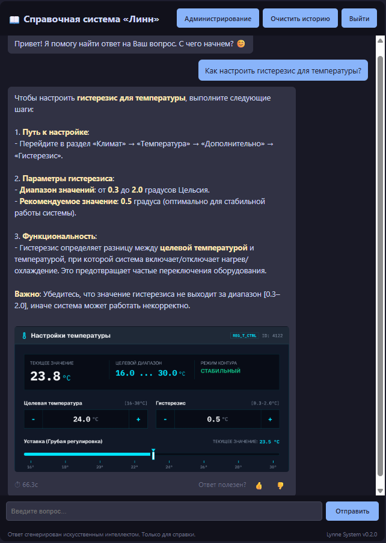
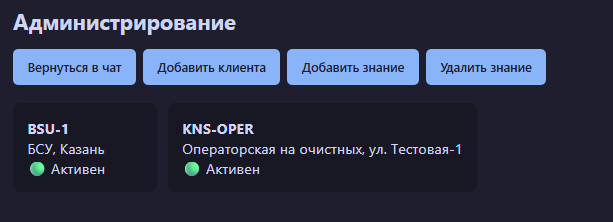
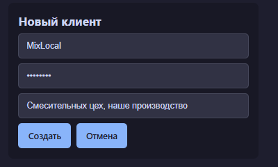
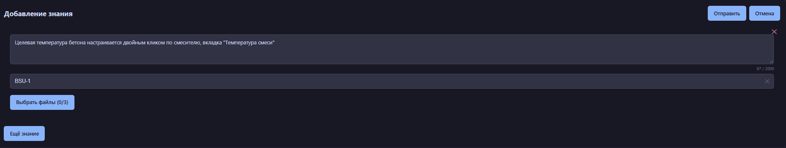
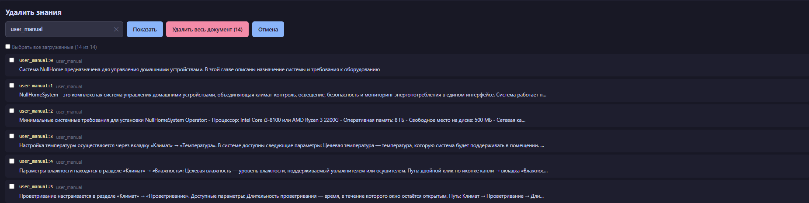
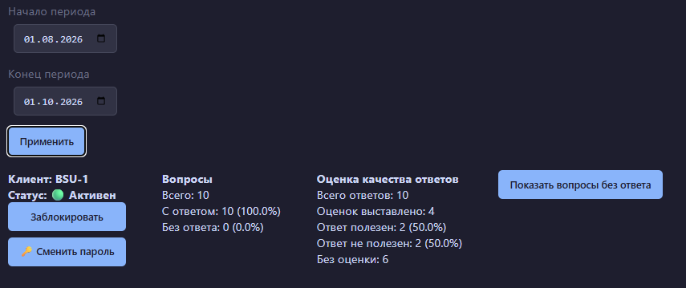

# Система Линн: Руководства

**Self-hosted RAG-ассистент по технической документации.**

Отвечает на вопросы операторов на естественном языке, опираясь **только** на внутренние инструкции и руководства.
Работает **полностью offline**: данные не покидают контур, ответы формируются локальной LLM без выхода в интернет.

---
## Применимость

Изначально разработан для операторов АСУТП как первая линия техподдержки.
Архитектура универсальна — подходит для любой компании с внутренней техдокой:

- **Обучение персонала** — новый сотрудник задаёт вопросы по регламентам.
- **Онбординг** — быстрый доступ к инструкциям без поиска по папкам.
- **Корпоративная база знаний** — вместо «спроси у соседа, он знает».
- **Изолированные контуры** — данные не покидают сервер, интернет не нужен.
  
---

## Проблема

На производстве оператор тратит **10–15 минут** на поиск ответа в инструкции на 200 страниц. Если вопрос нетипичный — звонит в техподдержку и ждёт. Если ответа нет — ищет в бумажных регламентах, а в это время производство простаивает.

Облачные LLM (ChatGPT, Claude) **не подходят**: данные чувствительные, интернет на объектах часто недоступен или ограничен, а галлюцинации в промышленности недопустимы.

---

## Решение

Локальный RAG-ассистент, который:

1. **Индексирует документацию** — документ автоматически парсится, разбивается на смысловые блоки, складывается в БД.
2. **Ищет релевантные фрагменты** — при запросе от пользователя.
3. **Генерирует ответ** — локальная LLM отвечает **строго по контексту**, с картинками и схемами из документации.
4. **Не галлюцинирует** — если ответа нет в документации, система честно говорит «не нашёл» и сохраняет вопрос для пополнения базы.
   

---

## Ключевые инженерные решения

### Гибридный поиск (dense + BM25 через RRF)

Dense-поиск ловит семантику, но промахивается на точных терминах. BM25 — наоборот: точен на терминах, слаб на перефразировании.

**RRF** объединяет результаты.

### Детектор галлюцинаций

В промышленности **недопустимо**, чтобы LLM выдумала число или параметр.
Реализован детектор галлюцинаций: система отвечает строго по контексту, а при отсутствии ответа честно сообщает об этом и сохраняет вопрос для пополнения базы знаний.

### Автоиндексация

При добавлении нового документа в папку с мануалами система автоматически запускает переиндексацию, новые знания попадают в базу и готовы к использованию.

Также можно добавлять новые знания точечно через панель администрирования: как общие, так и для конкретного клиента.

---

## Администрирование

Встроенная веб-панель для удобного управления системой без доступа к БД и API.

### Управление клиентами

- **Список клиентов** — логин, описание, статус (активен/заблокирован).
- **Добавление клиента** — логин, пароль, описание.

### Управление базой знаний

- **Добавление знаний** — текст, привязка к клиенту (или общие знания), привязка картинок.
- **Удаление знаний** — целиком документ или по отдельным фрагментам.
- **Просмотр источников** — список загруженных документов.

### Аналитика по клиенту

- **Период** — выбор диапазона дат (начало / конец).
- **Всего вопросов** — общее количество за период.
- **С ответом** — сколько вопросов получили ответ (в абсолюте и процентах).
- **Без ответа** — сколько осталось без ответа (в абсолюте и процентах).
- **Оценка качества** — распределение оценок: полезен / не полезен / без оценки.
- **Просмотр вопросов без ответа** — для пополнения базы знаний.
- **Блокировка / разблокировка** клиента.
- **Смена пароля** учетной записи клиента.
  

## Технические детали

### Хранение

- **PostgreSQL + pgvector**

### Multi-user

- **История диалогов**.
- **Разделение знаний**. Общие знания видят все, индивидуальные — только таргет-клиенты.

### Безопасность

- **Аутентификация пользователей**.
- **Rate limiting**  — защита от брутфорса и спама.
- **Офлайн-лицензирование с аппаратной привязкой**.

### Наблюдаемость

- **Prometheus** — латентности (retrieval/embed/rerank/MMR/LLM), распределение top-1 score, cache hit/miss.
- **Телеметрия в БД** — полный трейс поиска для оффлайн-анализа.
- **Health-check** — мониторинг состояния системы.

---

## Eval-пайплайн

Встроенный eval для измерения качества поиска:

- **Golden set** — вопросы с эталонными фрагментами документации.
- **Метрики** — Recall@5, MRR, разбивка по категориям (фактические / процедурные / негативные).
- **CSV-выгрузка** — для ручного анализа ошибок.
- **Поддержка негативных кейсов** — если эталона нет, пустой top = правильный ответ.
