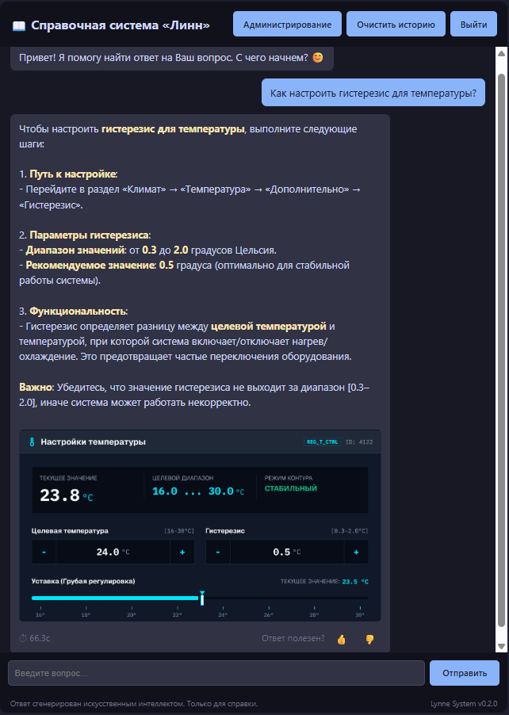
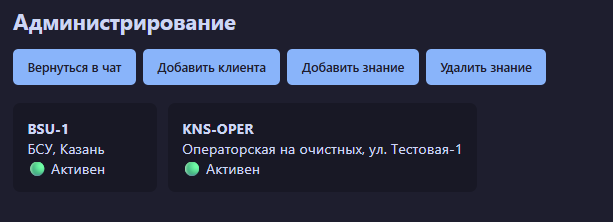
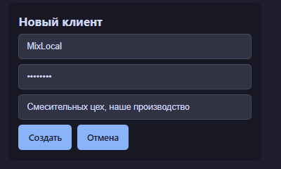
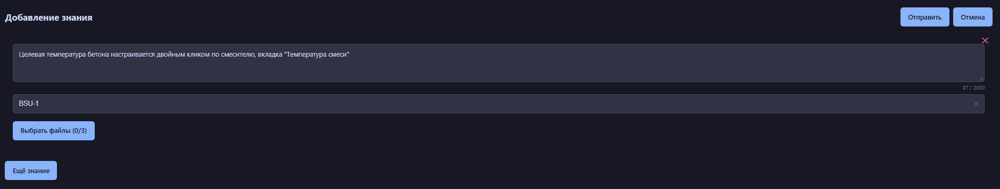
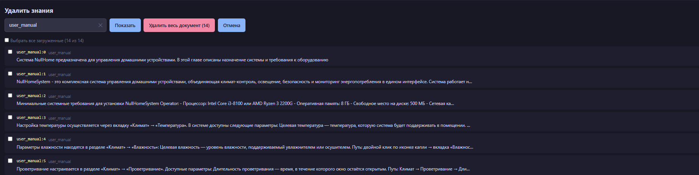
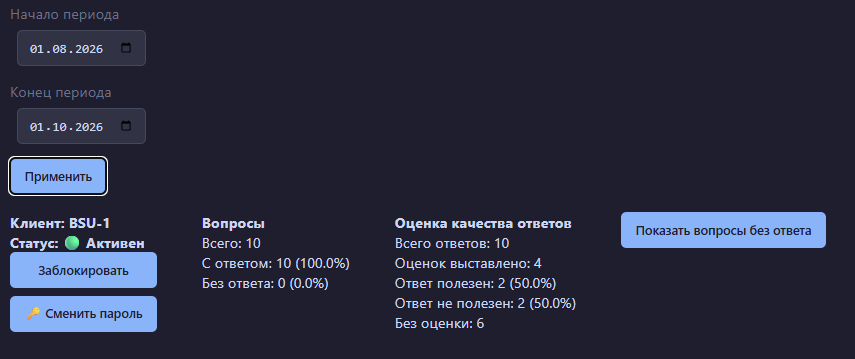
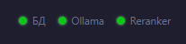

# Lynne System

**Self-hosted RAG-ассистент по технической документации.**

Отвечает на вопросы операторов на естественном языке, опираясь **только** на внутренние инструкции и руководства. Работает **полностью offline**: данные не покидают контур, ответы формируются локальной LLM без выхода в интернет.

---
## Применимость

Изначально разработан под операторов АСУТП как первая линия техподдержки.
Архитектура универсальна — подходит для любой компании с внутренней техдокой:

- **Обучение персонала** — новый сотрудник задаёт вопросы по регламентам.
- **Онбординг** — быстрый доступ к инструкциям без поиска по папкам.
- **Корпоративная база знаний** — вместо «спроси у соседа, он знает».
- **Изолированные контуры** — данные не покидают сервер, интернет не нужен.
  
---

## Проблема

На производстве оператор тратит **10–15 минут** на поиск ответа в PDF-инструкции на 200 страниц. Если вопрос нетипичный — звонит в техподдержку и ждёт. Если ответа нет — ищет в бумажных регламентах.

Облачные LLM (ChatGPT, Claude) **не подходят**: данные чувствительные, интернет на объектах часто недоступен или ограничен, а галлюцинации в промышленности недопустимы.

---

## Решение

Локальный RAG-ассистент, который:

1. **Индексирует документацию** — .docx с картинками автоматически парсится, чанкуется по заголовкам, эмбеддится и складывается в векторную БД.
2. **Ищет релевантные фрагменты** — гибридный поиск (dense + BM25) + реранкер + MMR.
3. **Генерирует ответ** — локальная LLM (Qwen3) отвечает **строго по контексту**, с картинками из документации.
4. **Не галлюцинирует** — если ответа нет в документации, система честно говорит «не нашёл» и сохраняет вопрос для пополнения базы.
   

---

## Как это работает

Вопрос оператора → Гибридный поиск по документации → Локальная LLM (Qwen3) отвечает только по найденному контексту → Ответ + картинки из документации

---

## Ключевые инженерные решения

### Гибридный поиск (dense + BM25 через RRF)

Dense-поиск ловит семантику, но промахивается на точных терминах. BM25 — наоборот: точен на терминах, слаб на перефразировании.

**RRF** объединяет результаты. Это устойчиво к разным шкалам (косинус vs BM25 score) и не требует подбора параметров.

### Кросс-энкодер реранкер

Bi-энкодер (dense) оценивает релевантность **грубо** — он сравнивает векторы, а не тексты. Кросс-энкодер (Qwen3-Reranker) получает **пару** (вопрос, документ) и выдаёт **точный** score.

### MMR-дедупликация

Реранкер сортирует по релевантности, но топ может быть **про одно и то же**. MMR добавляет разнообразие - это даёт **разные аспекты** в контексте, а не пять копий одного абзаца.

### Детектор галлюцинаций

В промышленности **недопустимо**, чтобы LLM выдумала число или параметр. Система:

1. Использует строгий system prompt («только из контекста», запрет добавлять числа/параметры).
2. Детектирует отказные ответы LLM.
3. Сохраняет **неотвеченные вопросы** в отдельную таблицу → для пополнения базы знаний.

### Автоиндексация через fsnotify

Документация обновляется — новый документ (новая большая инстркция\база знаний) падает в папку с мануалами. Watcher ловит событие и запускает переиндексацию, новые знания попадают в базу и готовы к использованию.

Также можно добавлять новые знания точечно через панель администрирования как общие, так и для конкретного клиента.

---

## Администрирование

Встроенная веб-панель для управления системой без доступа к БД и API.

### Управление клиентами

- **Список клиентов** — логин, описание, статус (активен/заблокирован).
- **Добавление клиента** — логин, пароль, описание.

### Управление базой знаний

- **Добавление знаний** — текст, привязка к клиенту (или общие знания), до 3 картинок на элемент.
- **Удаление знаний** — по источнику (целиком документ) или по конкретным знаниям (чанкам).
- **Просмотр источников** — список загруженных документов с количеством чанков.

### Аналитика по клиенту

- **Период** — выбор диапазона дат (начало / конец).
- **Всего вопросов** — общее количество за период.
- **С ответом** — сколько вопросов получили ответ (в абсолюте и процентах).
- **Без ответа** — сколько осталось без ответа (в абсолюте и процентах).
- **Оценка качества** — распределение оценок: полезен / не полезен / без оценки.
- **Просмотр вопросов без ответа** — для пополнения базы знаний.
- **Блокировка / разблокировка** — при блокировке все активные сессии пользователя завершаются.
- **Смена пароля** — при смене пароля все сессии пользователя инвалидируются.
  

### Статус системы

В шапке панели — индикаторы здоровья:
- **БД** — доступность PostgreSQL.
- **Ollama** — доступность LLM-сервера.
- **Reranker** — доступность реранкера.

## Технические детали

### Хранение

- **PostgreSQL 18 + pgvector**
- **HNSW**
- **BM25-ветка**
- **Частичный индекс** для ускорения фильтра при поиске общих знаний.

### LLM

- **Генерация** — Qwen3 8B через Ollama, streaming SSE.
- **Эмбеддинги** — Qwen3-Embedding-4B.
- **Реранкер** — Qwen3-Reranker через llama.cpp.
- **Query rewriting** — отдельный вызов LLM с few-shot'ами, эвристики против «ответа вместо переформулировки».

### Multi-user

- **Сессии** — in-memory, криптостойкие ID, TTL 24 часа.
- **История диалогов**.
- **Разделение знаний**. Общие знания видят все, индивидуальные - только таргет-клиенты.

### Безопасность

- **Аутентификация** — bcrypt + сессии.
- **Rate limiting** — скользящее окно: 5 запросов/мин на сессию для вопросов, 5 попыток/5 мин на IP для логина.
- **Офлайн-лицензирование** — Ed25519 с привязкой к hardware ID (WMI: motherboard + UUID), защита от отката часов, хранение в реестре Windows.

### Observability

- **Prometheus** — латентности (retrieval/embed/rerank/MMR/LLM), распределение top-1 score, cache hit/miss.
- **Телеметрия в БД** — таблица `retrieval_logs` с полным трейсом поиска (JSONB hits, ранги, scores) для оффлайн-анализа.
- **Health-check** — `/health` с градацией `ok/degraded/unhealthy`.
- **pprof** — на `localhost:6060`. Встроенный профайлер Go для диагностики утечек, памяти и CPU

---

## Eval-пайплайн

Встроенный eval для измерения качества поиска:

- **Golden set** в JSONL — вопросы с эталонными chunk_id.
- **Метрики** — Recall@5, MRR, разбивка по категориям (фактические / процедурные / негативные).
- **CSV-выгрузка** — для ручного анализа ошибок.
- **Поддержка негативных кейсов** — если эталона нет, пустой top = правильный ответ.

---

## Стек

| Слой | Технологии |
|---|---|
| **Язык** | Go 1.26 |
| **БД** | PostgreSQL 18 + pgvector (halfvec 2560, HNSW) |
| **LLM** | Ollama, Qwen3 8B |
| **Embeddings** | Qwen3-Embedding-4B |
| **Reranker** | Qwen3-Reranker (llama.cpp) |
| **SQL** | sqlc + pgx/v5 |
| **Наблюдаемость** | Prometheus, pprof |
| **Spellcheck** | SymSpell |
| **Безопасность** | bcrypt, Ed25519, rate limiting |
| **Деплой** | NSSM (Windows Service), portable-комплект |

---

## Что внутри

- **Гибридный поиск** — dense + BM25 через RRF.
- **Кросс-энкодер реранкер** + **MMR-дедупликация**.
- **Query rewriting** по истории диалога.
- **Детектор галлюцинаций** + сохранение неотвеченных вопросов.
- **Автоиндексация** .docx через fsnotify (debounce + advisory lock).
- **Multi-user** — сессии, история, разделение знаний.
- **Управление базой знаний** через API + админ-панель.
- **Обратная связь** — полезно/бесполезно/не отвечено + аналитика по клиентам.
- **Observability** — Prometheus + телеметрия в БД + health-check + pprof.
- **Офлайн-лицензирование** — Ed25519 + hardware ID.
- **Деплой на Windows** — NSSM-сервисы + portable-комплект моделей.

---
